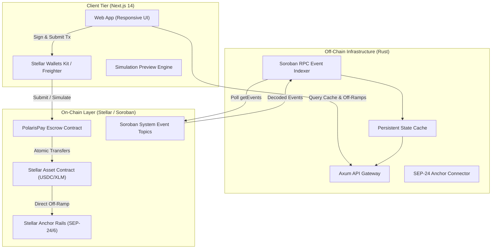
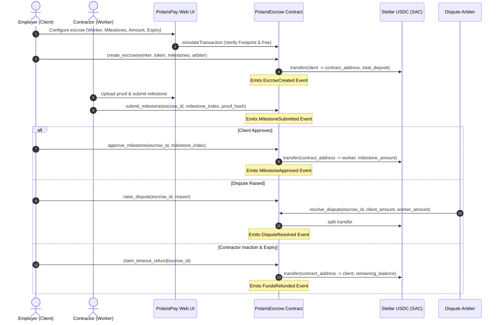

# Stellar PolarisPay Architecture Specification

## 1. Executive Summary

**Stellar PolarisPay** is a production-grade, non-custodial programmable escrow and milestone disbursement protocol built natively and exclusively on the **Stellar network** using **Soroban smart contracts**.

Designed specifically for cross-border contractor payouts, DAO grants, and remote freelance arrangements, PolarisPay eliminates the traditional trust deficit between global employers and talent. Employers lock funds (such as native Stellar USDC) into a milestone-governed Soroban vault. As verifiable deliverables are submitted, funds unlock instantaneously upon approval or stream directly into off-ramp rails powered by Stellar's SEP-24/SEP-6 anchor network.

---

## 2. High-Level System Architecture

---

## 3. Protocol Components

### 3.1 On-Chain Smart Contracts (`/contracts`)
* **Framework**: Soroban SDK (`soroban-sdk = "21.0.0"`, `#![no_std]`, targeting `wasm32-unknown-unknown`).
* **Storage Strategy**:
  * **Instance Storage**: Contract configuration, global admin public key, protocol fee parameters, and pause switch.
  * **Persistent Storage**: Escrow records and individual milestone specifications. State TTL is extended programmatically during state interactions (`extend_ttl`) to ensure long-term availability on Stellar ledgers without unexpected state archival.
* **Token Compatibility**: Strictly conforms to the **Stellar Asset Contract (SAC)** interface (`SEP-41` compatible). Supports native USDC, EURC, and custom anchored fiat assets.
* **Security & Auth**: Explicit multi-party authorization using `Address::require_auth()`. No single-point admin backdoor can siphon escrowed deposits.

### 3.2 Off-Chain Indexer & Backend Gateway (`/backend`)
* **Technology**: Written in **Rust** using the high-performance **Axum** framework.
* **Event Indexing**: Continuously queries the Soroban RPC `getEvents` endpoint filtered by the Polaris contract address and event topics.
* **State Caching**: Provides fast REST queries for escrow dashboards without straining client RPC rate limits.
* **Anchor Bridge (SEP-24/6)**: Queries anchor directories to provide quotes for immediate local currency bank or mobile money deposits (NGN, BRL, KES, PHP, EUR).

### 3.3 Web Client (`/web`)
* **Technology**: Next.js 14 (App Router) + TypeScript + Tailwind CSS.
* **Stellar Integration**: `@stellar/stellar-sdk` and **Stellar Wallets Kit** supporting Freighter, xBull, and Albedo.
* **Pre-flight Simulation**: Simulates all transaction invocations against Soroban RPC to render resource footprint, minimum fee, and transaction previews before wallet signing.

---

## 4. End-to-End Core Lifecycle

---

## 5. Why Stellar?

1. **Deterministic Fast Finality (3–5 seconds)**: Milestones can be approved and settled in seconds, not hours.
2. **Predictable Sub-Cent Fees (< \$0.001)**: Allows multi-milestone micro-releases without gas penalty.
3. **Native Asset Ecosystem (SAC)**: First-class interoperability between classic Stellar trustline assets (Circle USDC) and Soroban contracts.
4. **SEP Anchors**: Direct fiat on/off-ramps allow global workers to receive their local currency directly in bank accounts or mobile wallets without leaving the Stellar network.
